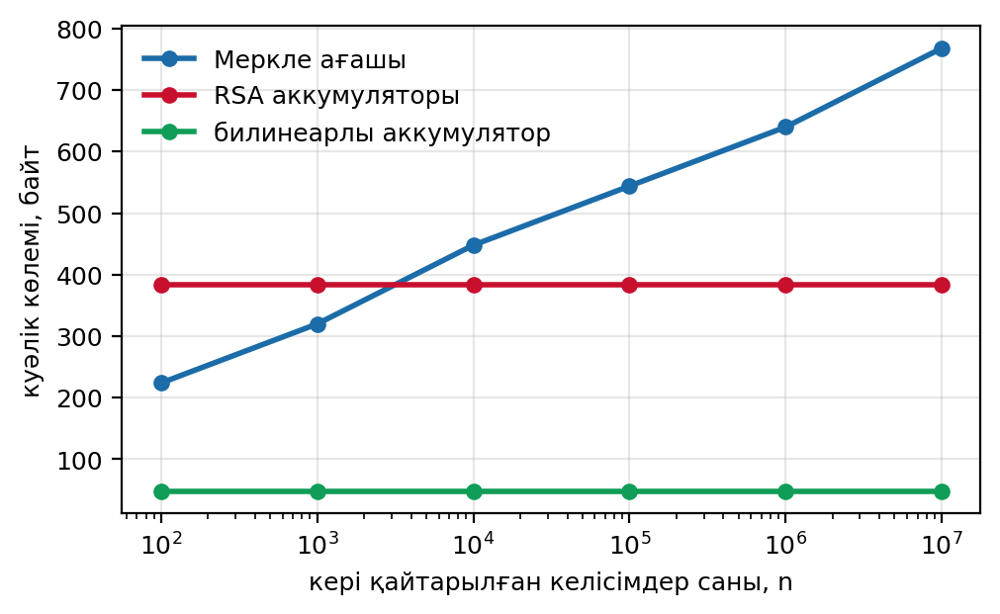
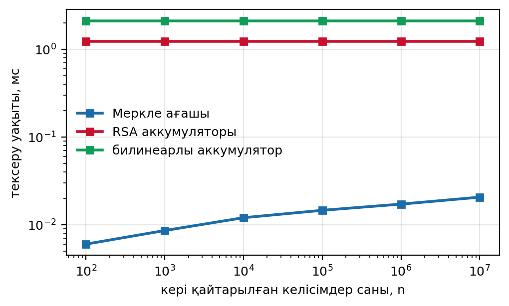
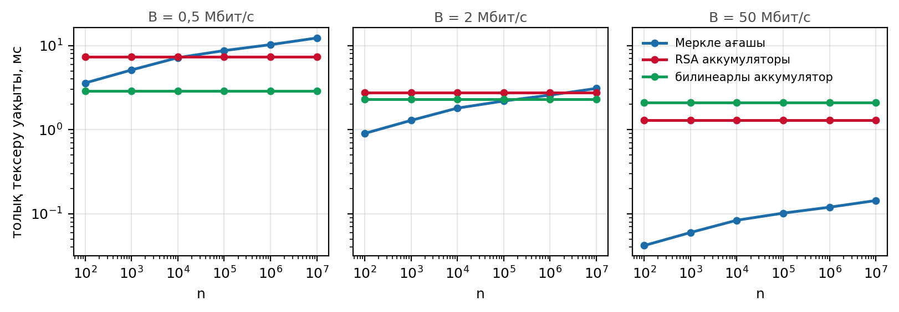
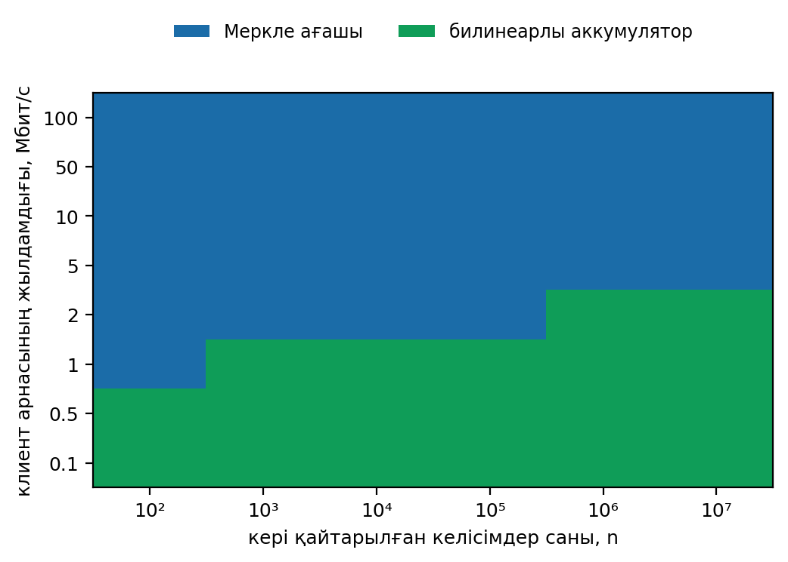

# Consent revocation primitives: Merkle trees vs cryptographic accumulators

[](LICENSE)
[](https://www.python.org/)
[](#quick-start)

Code, measurements and figures for the article

> Е. Ә. Айкенов. *Гибридті блокчейн медициналық жүйелерінде келісімді кері
> қайтару үшін криптографиялық аккумуляторлар мен Меркле ағаштарын
> салыстырмалы талдау.* EKTU Journal of Information Security and Cryptography.

The repository reproduces **every number, table and figure** in the paper and
checks them automatically against the values printed in the text.

---

## Quick start

```bash
python3 -m venv .venv
source .venv/bin/activate        # Windows: .venv\Scripts\activate
pip install -r requirements.txt
python run_all.py
```

The last line should read `ALL PASS`.

## Two ways to run

| Command | What it does |
| --- | --- |
| `python run_all.py` | Uses the measurements shipped in `results/bench.json` and reproduces the paper exactly. |
| `python run_all.py --measure` | Re-measures on *your* machine (seven series, about ten minutes) and recomputes everything from the new medians. The structure of the result holds; the numbers move with your hardware, and `check_paper.py` lists the differences. |

## Measured parameters

Verifier-side medians over seven independent series, from `results/bench.json`.

| Operation | Symbol | Value |
| --- | --- | --- |
| SHA-256 over one 64-byte node | `t_h` | 0.859 µs |
| RSA-3072 verification, prime derived by the verifier | `t_R` | 1.232 ms |
| RSA-3072 verification, prime supplied by the prover | — | 0.863 ms |
| RSA-3072 with a full 3072-bit exponent | — | 8.668 ms |
| BLS12-381 verification (one G2 multiplication + two pairings) | `t_B` | 2.111 ms |
| BLS12-381 single pairing | — | 1.501 ms |

Measured ratio `t_R / t_B` = **0.583**; the critical ratio below which the RSA
accumulator starts to win cells of the decision map is **0.53**.

## Results at a glance

- The Merkle witness grows as `log n` (224 B at n = 10², 768 B at n = 10⁷),
  while the accumulator witness stays constant — 384 B for RSA, 48 B for BLS.
- Verification time is the mirror image: Merkle stays under 0.021 ms at every
  size, RSA costs 1.23 ms and BLS 2.11 ms regardless of n.
- Which one wins the *total* latency therefore depends on the client channel.
  The bandwidth threshold runs from 0.67 Mbit/s at n = 10² to 2.76 Mbit/s at
  n = 10⁷: below it the bilinear accumulator wins, above it the Merkle tree.
- The RSA accumulator wins no cell of the decision map under the measured
  parameters. It wins a narrow window around n = 10⁷ only when the prover
  supplies the prime representative, or when the pairing cost doubles.

## Figures

| | |
| --- | --- |
|  |  |
| **Figure 1.** Witness size against the number of revoked consents `n`. | **Figure 2.** Verification time against `n` (log scale). |



**Figure 3.** Total verification latency (transfer + verification) at B = 0.5,
2 and 50 Mbit/s. The crossover moves right as the channel gets faster.



**Figure 4.** Decision map: the winning primitive for each pair
(`n`, bandwidth). Under the measured parameters only the Merkle tree and the
bilinear accumulator ever win.

## Repository layout

```text
src/bench.py         measures t_h, t_R, t_B (SHA-256, RSA-3072, BLS12-381)
src/model.py         witness size, verification time, total latency, decision map
src/robustness.py    sensitivity to the timing parameters, critical ratio t_R/t_B
src/bench_repeat.py  runs bench.py as seven independent series, reports the spread
src/check_paper.py   compares 36 printed values with the results (PASS/FAIL)
results/             bench.json (series medians), bench_series.json (all series),
                     model_results.json, robustness.json
figures/             fig1.png ... fig4.png  (Figures 1-4 of the paper)
```

## What maps to what

| Paper | Source |
| --- | --- |
| Table 1, measured parameters | `results/bench.json` |
| Figures 1–4 | `figures/fig1.png` … `figures/fig4.png` |
| Table 2, bandwidth thresholds | `results/model_results.json` → `bandwidth_threshold` |
| Decision map, winning primitive per cell | `results/model_results.json` → `grid`, `grid_matrix` |
| RSA winning cells, narrow window at n = 10⁷ | `results/model_results.json` → `rsa_given_wins` |
| Robustness paragraph, critical ratio 0.53 | `results/robustness.json` |
| Spread across series | `results/bench_series.json` |

## Measurement method

Verifier-side operations only, one thread. Each operation is repeated at least
200 times; the whole benchmark runs as seven independent series and the paper
reports the series medians. `results/bench_series.json` keeps every series, so
the spread quoted in the paper (for example `t_R / t_B` between 0.56 and 0.66)
can be checked directly.

- **Merkle:** one SHA-256 over a 64-byte node.
- **RSA accumulator:** 3072-bit modulus (128-bit security, NIST SP 800-57);
  the verifier derives a 256-bit prime representative by hash-to-prime and
  performs one modular exponentiation with that prime as exponent. A full-size
  3072-bit exponent is also timed, to show why the two must not be confused.
- **Bilinear accumulator:** BLS12-381; one G2 scalar multiplication plus a
  two-pairing product.

Reference host: Intel Xeon 2.1 GHz, Python 3.12, GMP 6.3.0, arkworks BLS12-381.

## Citation and licence

If you use this code, please cite the article — see [`CITATION.cff`](CITATION.cff).
Code is released under the [MIT licence](LICENSE).
